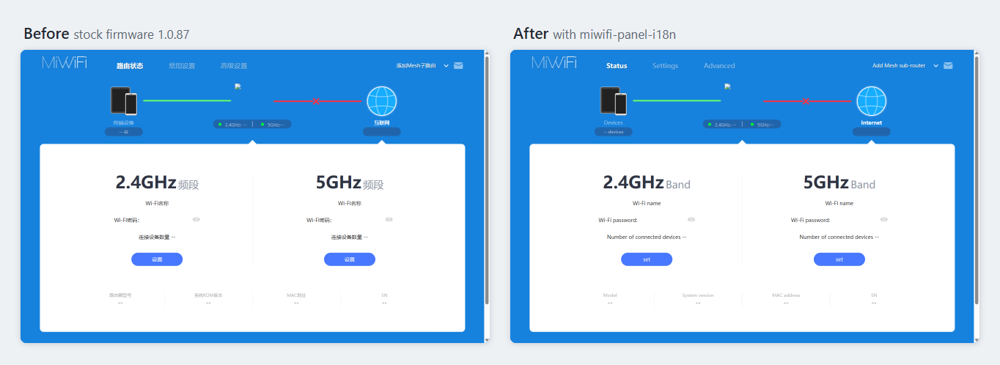
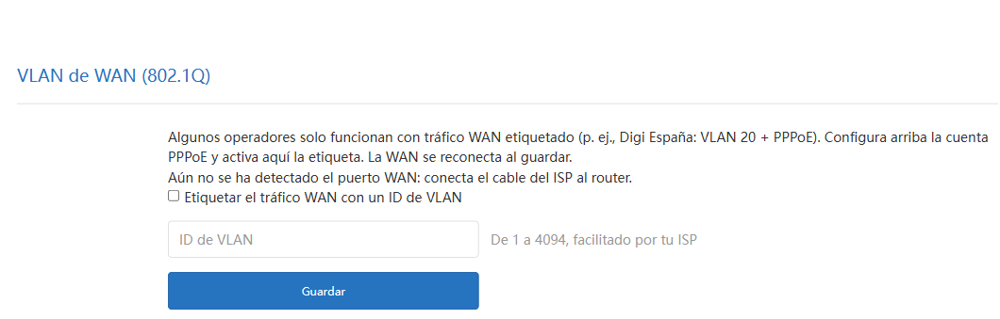
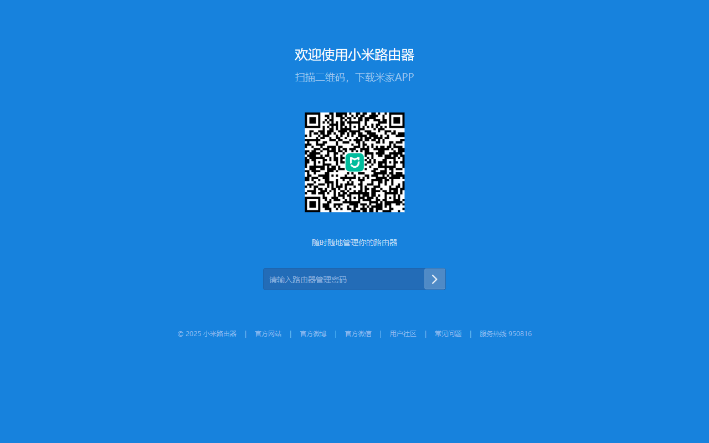
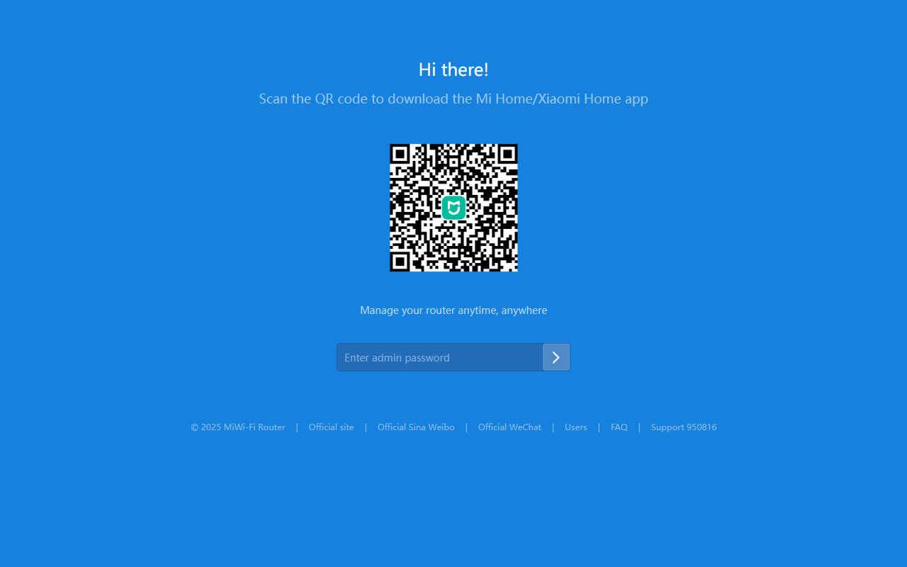
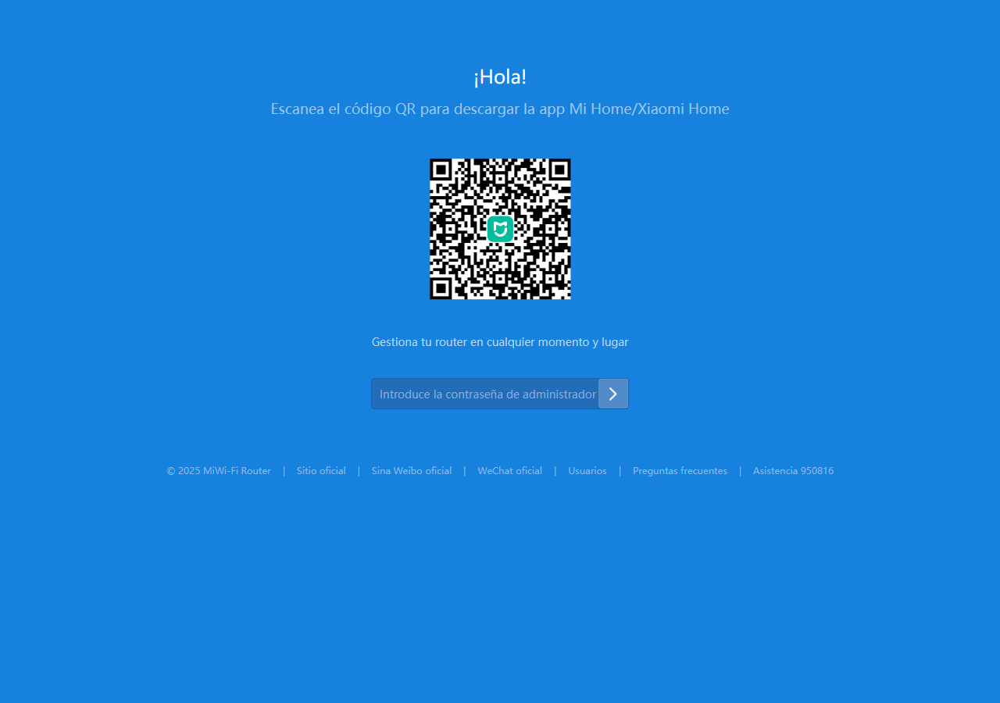
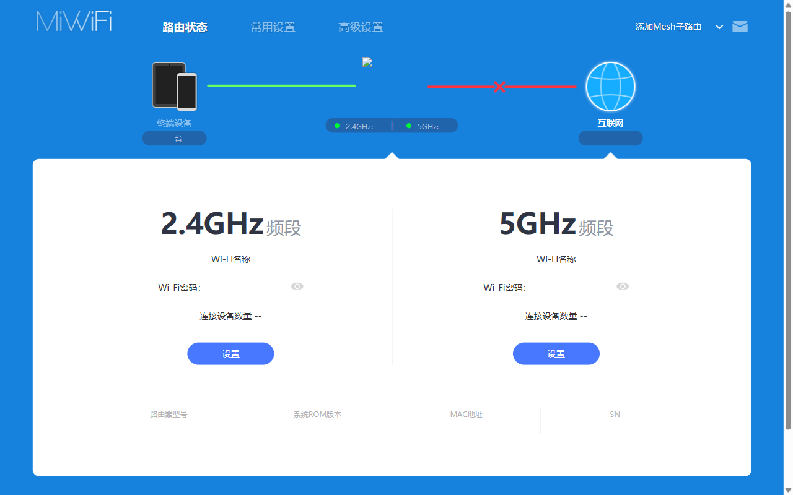
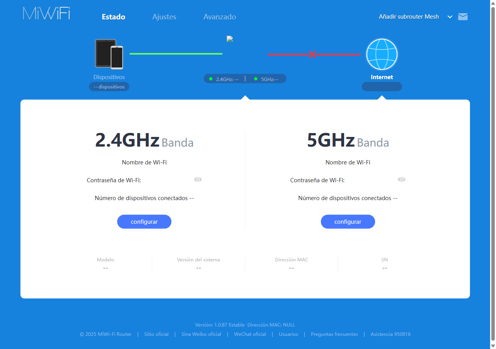

# miwifi-panel-i18n

**El panel web de los routers Xiaomi con firmware original en tu idioma, y un ajuste de VLAN en la WAN.**

[](https://github.com/esdedev/miwifi-panel-i18n/actions/workflows/ci.yml)
[](https://github.com/esdedev/miwifi-panel-i18n/releases)
[](LICENSE)

[English](README.md)

> [!IMPORTANT]
> **Necesitas acceso root al router.** Instalar (y quitar) el paquete requiere acceso root por SSH,
> que el firmware original no da. Este proyecto no incluye ninguna forma de conseguirlo;
> [Conseguir root](#conseguir-root) enlaza a un método público de la comunidad, que usas bajo tu
> responsabilidad. Sin root, este proyecto no se puede instalar.



El firmware chino de Xiaomi solo viene en chino, y su panel no permite etiquetar el tráfico de la
WAN con una VLAN. Algunos operadores lo necesitan: Digi en España, por ejemplo, usa PPPoE en la
VLAN 20. Este paquete añade tres cosas al panel que ya tienes:

- **El panel en tu idioma**: los menús, todas las páginas de ajustes, los mensajes y las páginas
  nuevas hechas en JavaScript. Las traducciones son ficheros JSON sencillos que cualquiera puede
  mejorar o ampliar con una pull request (ver [Idiomas](#idiomas)).
- **Un menú de idioma** en *Ajustes → Ajustes del sistema*, para poder volver al chino.
- **VLAN de WAN (802.1Q)** en *Ajustes → Ajustes de red*. Marca la casilla, escribe el ID de
  VLAN y guarda.

No se escribe nada en el firmware. El paquete vive en `/data`, se aplica en cada arranque, y un
solo comando deja el router exactamente como estaba antes.

## Idiomas

| Idioma | Código | Textos |
|---|---|---|
| English | `en` | completo; es la base de todos los demás |
| Español | `es` | completo |

¿Falta el tuyo? Créalo con `python tools/lang.py update <código>`, traduce el texto en inglés y
abre una pull request: [CONTRIBUTING.md](CONTRIBUTING.md). Lo que un idioma aún no tenga se ve
en inglés.

## Estado

| Firmware | Estado |
|---|---|
| Xiaomi BE3600 2.5G (RD15) 1.0.87 | **Probado en un router real**: instalación en español, reinicio, ajuste de VLAN de WAN, `remove` y `restore` |

Solo se ha probado este modelo y esta versión. En cualquier otro firmware, `install` muestra un
aviso y pregunta antes de seguir.

En el router real, al guardar el ajuste de VLAN desde el panel, el router creó el dispositivo
etiquetado (`eth1.20` en el puerto 2.5G) y lo usó para la WAN.

El paquete se genera a partir de **los ficheros de tu propio router**, así que siempre encaja con
el firmware que tienes. Cada cambio es una sustitución de texto pequeña y exacta. Si un cambio no
encaja en tu firmware, la generación deja fuera esa función y te avisa; nunca escribe un fichero
a medio parchear. Antes de aplicar nada, el router comprueba el SHA-256 de cada fichero original.
Si algo no coincide, por ejemplo tras una actualización de firmware, no aplica nada y el panel
original sigue funcionando.

Si lo pruebas en otro modelo o versión, abre una issue contando cómo fue.

## Qué necesitas

- **Acceso root por SSH** al router. Hace falta para instalar, para quitar y para restaurar. Una
  vez instalado, el paquete sigue funcionando tras los reinicios sin necesidad de más acceso.
  Mira [Conseguir root](#conseguir-root).
- Un PC con **Python 3.10+** y el comando `ssh` (viene con Windows 10/11, macOS y Linux).
- Opcional: **Node.js**, para comprobar la sintaxis de cada script modificado al generar.

### Conseguir root

Este proyecto no incluye ninguna forma de conseguir root. Este proyecto público de la comunidad
sí; lee sus instrucciones y advertencias antes de usarlo, bajo tu responsabilidad:

| Proyecto | Qué es | En el BE3600 2.5G (RD15) |
|---|---|---|
| [xiaomi-rp01-root](https://github.com/perrywey/xiaomi-rp01-root) | Scripts cortos para el BE3600 Pro (RP01, RP02) | Así se consiguió root en el RD15 1.0.87, el router con el que se probó este proyecto |

Antes de empezar:

- Los métodos de root dependen de la versión del firmware, y Xiaomi los cierra en las
  actualizaciones. **No actualices el firmware** antes de tener root si tu versión tiene un método
  conocido.
- **Los routers Xiaomi no aceptan un firmware más antiguo** (anti-rollback): una vez actualizas, no
  puedes volver a una versión en la que funcionaba un método.
- Hacer root puede anular la garantía. Haz una copia de seguridad de la memoria del router si la
  herramienta lo permite.

## Instalar

```sh
git clone https://github.com/esdedev/miwifi-panel-i18n
cd miwifi-panel-i18n
python router.py fetch 192.168.31.1      # copia los ficheros web del router (unos 5 MB) a ./rootfs
python build.py --lang es                # genera el paquete en ./build/pack (por defecto, --lang en)
python router.py install 192.168.31.1    # lo sube y lo activa
```

Después recarga `http://192.168.31.1` con Ctrl+F5. Cada comando pide la contraseña root del
router como mucho una vez (o usa tu clave SSH). En un firmware distinto del RD15 1.0.87,
`install` muestra el informe de la generación y pregunta antes de seguir. Para cambiar de idioma
más tarde, genera de nuevo con otro `--lang` y vuelve a ejecutar `install`.

Todos los textos que muestra el panel en el firmware soportado los traduce este proyecto. Para los
pocos que no tiene (sobre todo mensajes del código compilado del router), `build.py` descarga la
primera vez el `base.en.po` comunitario de xmir-patcher desde un commit fijo y comprueba su
SHA-256. Ese fichero no tiene licencia, así que ni él ni sus textos se incluyen aquí.

### Usar la VLAN de WAN

1. *Ajustes → Ajustes de red*: elige el tipo de conexión de tu operador (por ejemplo, PPPoE con
   tu usuario y contraseña) y guarda.
2. En **VLAN de WAN (802.1Q)**, marca *Etiquetar el tráfico WAN con un ID de VLAN*, escribe el
   ID (Digi España: 20) y guarda. La WAN se reconecta en unos segundos.

Para quitarla, desmarca la casilla y guarda.

Con la etiqueta activa, la detección automática del puerto WAN del router también busca a tu
operador **en esa VLAN**. Con un operador que usa la etiqueta (como Digi) es justo lo que quieres.
Si el puerto WAN no se detecta, elígelo a mano en *Ajustes → Ajustes de red*.



## Comprobar, quitar, restaurar

```sh
python router.py status  192.168.31.1   # qué hay instalado y si está aplicado
python router.py remove  192.168.31.1   # vuelve al panel chino original; el paquete queda en /data
python router.py restore 192.168.31.1   # lo deshace todo: el router queda como estaba antes
```

Antes de la primera instalación, el router guarda todo lo que el paquete va a cambiar: los
ajustes de idioma del panel, los de VLAN de la WAN y su crontab. `restore` vuelve a poner esos
valores tal cual (y borra los que no existían), quita la entrada de arranque, borra el paquete y
la copia, y reconecta la WAN si el ajuste de VLAN cambió. Reinstalar o actualizar el paquete
mantiene la primera copia, así que `restore` siempre vuelve al estado anterior a la primera
instalación.

**Tras una actualización de firmware** el router detecta que sus ficheros cambiaron y no aplica
el paquete. Para recuperar tu idioma, ejecuta `remove` y después `fetch`, `build` e `install`.

## Capturas

Hechas con el firmware original 1.0.87 en el [emulador](#probar-sin-router), por eso los datos en
vivo (clientes Wi-Fi, estado de la WAN) salen vacíos.

| Original | English | Español |
|---|---|---|
|  |  |  |
|  |  |  |


## Qué sigue en chino

- **Los textos legales de Xiaomi**: el acuerdo de usuario, la política de privacidad y el
  programa de experiencia de usuario. Traducirlos completos crearía obras derivadas de documentos
  protegidos, así que este repositorio no los incluye ([LEGAL.md](LEGAL.md)). Puedes añadir tus
  propias traducciones con `python build.py --extra mis-traducciones.local.json`.
- Mensajes escritos dentro del código Lua compilado del router, si alguno no está en el catálogo
  de traducciones, pueden seguir saliendo en chino.

La traducción de páginas del navegador cubre lo que quede.

## Cómo funciona

Ver [docs/how-it-works.md](docs/how-it-works.md) (en inglés): cómo se generan los idiomas, qué se
parchea y por qué la VLAN necesita un parche, cómo se aplica el paquete al arrancar, la copia y
la restauración, las comprobaciones de seguridad y los resultados de las pruebas.

## Probar sin router

`dev/emulator.sh` ejecuta el panel web original a partir de un fichero de firmware oficial en
Docker, con emulación arm64, con o sin el paquete:

```sh
sh dev/emulator.sh rootfs miwifi_rd15_firmware_0321a_1.0.87.bin   # ./rootfs, sin router
python build.py --lang es
sh dev/emulator.sh run miwifi_rd15_firmware_0321a_1.0.87.bin 8080 --pack
```

## Licencia

GPL-3.0 o posterior, ver [LICENSE](LICENSE). Sin relación con Xiaomi; ver [LEGAL.md](LEGAL.md).
