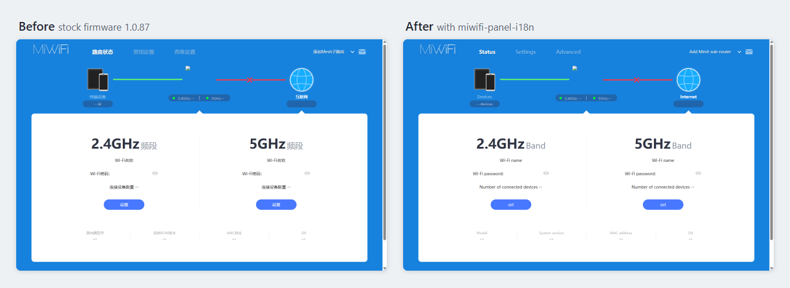
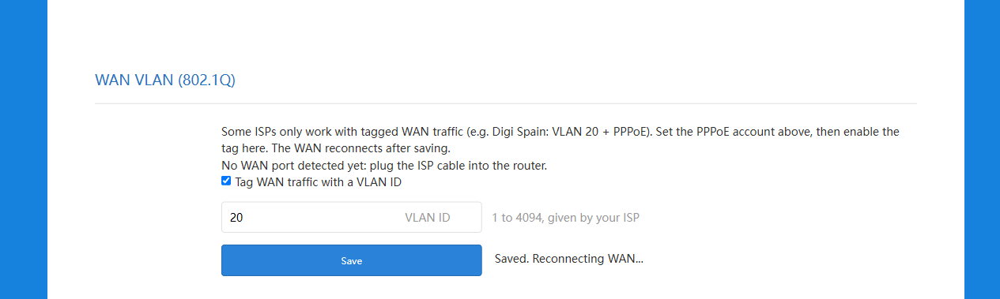
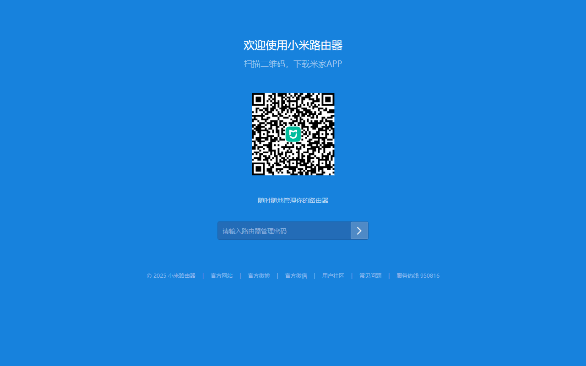
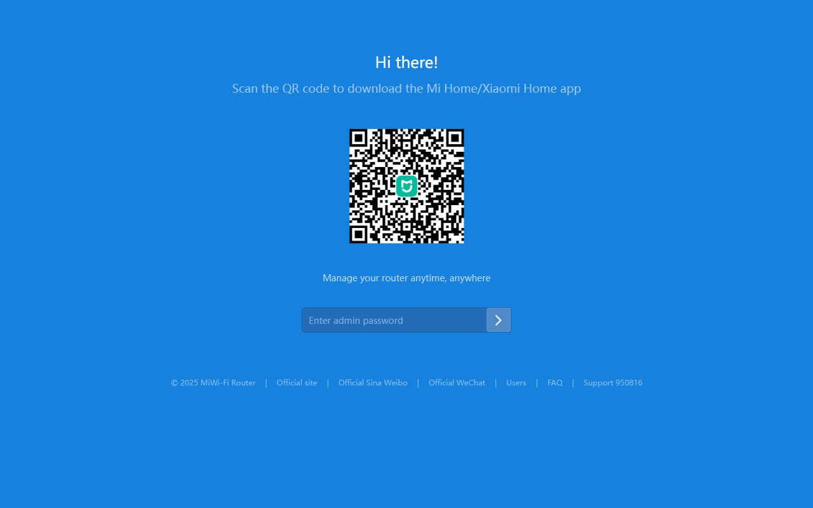
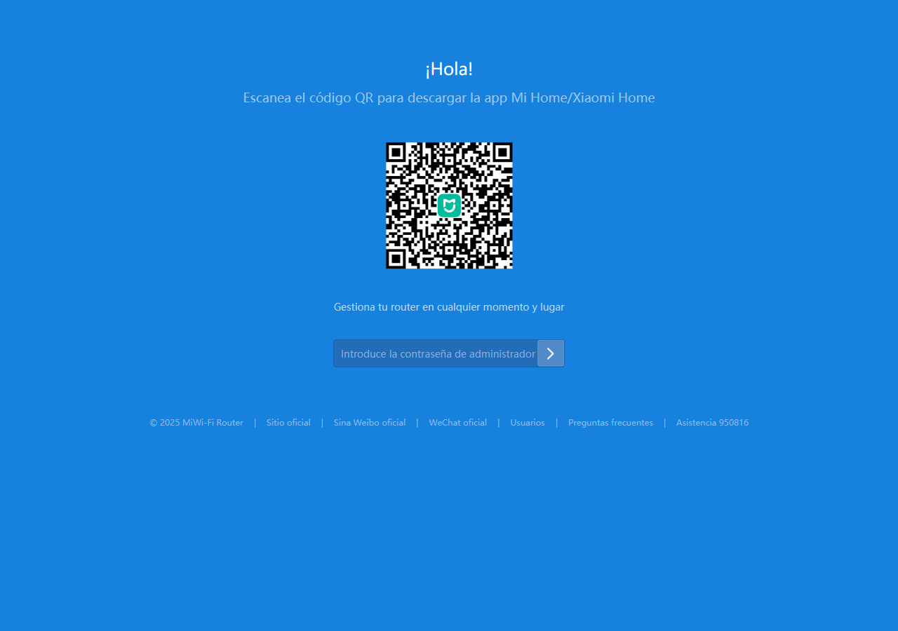
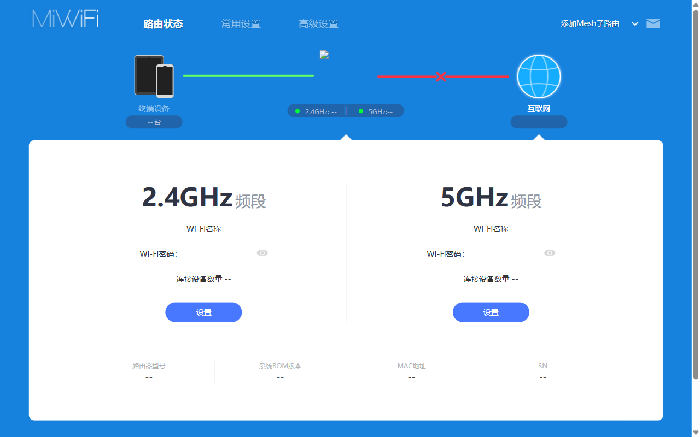
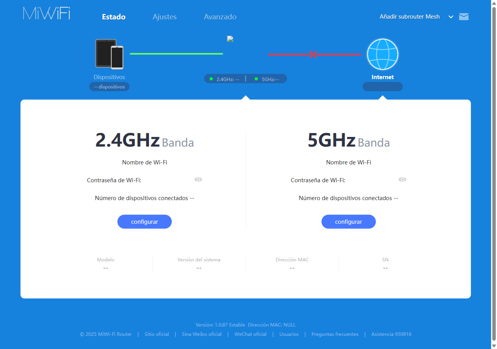

# miwifi-panel-i18n

**Your language in the web panel of Xiaomi routers on stock firmware, plus a WAN VLAN setting.**

[](https://github.com/esdedev/miwifi-panel-i18n/actions/workflows/ci.yml)
[](https://github.com/esdedev/miwifi-panel-i18n/releases)
[](LICENSE)

[Español](README.es.md)

> [!IMPORTANT]
> **You need root access to the router.** Installing (and removing) the pack requires root SSH
> access, which the stock firmware does not give you. This project does not include a way to get
> it; [Getting root](#getting-root) links to a public community method, used at your own risk.
> Without root, this project cannot be installed.



Xiaomi's China firmware only comes in Chinese, and its panel has no way to tag WAN traffic with a
VLAN. Some ISPs need that tag: Digi in Spain needs PPPoE on VLAN 20, and this pack has been
[tested with it](#tested-with-digi-spain). It adds three things to the panel you already have:

- **The panel in your language**: the menus, every settings page, the messages and the newer
  pages built in JavaScript. Translations are plain JSON files that anyone can improve or add
  to with a pull request (see [Languages](#languages)).
- **A language menu** in *Settings → System settings*, so you can switch back to Chinese.
- **WAN VLAN (802.1Q)** in *Settings → Network settings*. Tick the box, type the VLAN ID and save.

Nothing is written to the firmware. The pack lives in `/data`, is applied at each boot, and one
command puts the router back exactly as it was before.

## Tested with Digi (Spain)

Digi's fibre needs PPPoE on VLAN 20, which the stock panel cannot set. With the pack, the Xiaomi
works as the main router, plugged straight into Digi's fibre box (ONT):

1. *Settings → Network settings*: connection type PPPoE, with the user name and password from
   Digi. Save.
2. *WAN VLAN (802.1Q)*: tick *Tag WAN traffic with a VLAN ID*, type `20` and save.

Tested on a real BE3600 2.5G (RD15) with firmware 1.0.87 on a Digi fibre line: the router
connects and Internet works over the tagged WAN.

This project is not affiliated with, endorsed by or supported by Digi or Xiaomi.

## Languages

| Language | Code | Strings |
|---|---|---|
| English | `en` | complete, the source for every other language |
| Español | `es` | complete |

Missing your language? Copy it in with `python tools/lang.py update <code>`, translate the
English text and open a pull request: [CONTRIBUTING.md](CONTRIBUTING.md). A string a language
does not have yet is shown in English.

## Status

| Firmware | State |
|---|---|
| Xiaomi BE3600 2.5G (RD15) 1.0.87 | **Tested on a real router**: install in Spanish, reboot, Internet over Digi fibre with the WAN VLAN setting (VLAN 20, PPPoE), `remove` and `restore` |

Only this model and version has been tested. On any other firmware, `install` shows a warning
and asks before going ahead.

On the real router, saving the WAN VLAN setting from the panel made the router create the
tagged device (`eth1.20` on the 2.5G port) and use it for the WAN.

The pack is built from **your own router's files**, so it always matches the firmware you run.
Each change is a small exact text replacement. If a change does not fit your firmware, the build
leaves that feature out and tells you; it never writes a half-patched file. Before applying, the
router checks the SHA-256 of every original file. If anything differs, for example after a
firmware update, it applies nothing and the stock panel keeps working.

If you try it on another model or version, please open an issue saying how it went.

## What you need

- **Root SSH access** to the router. It is needed to install, to remove and to restore. Once
  installed, the pack keeps working after reboots without any further access. See
  [Getting root](#getting-root).
- A PC with **Python 3.10+** and the `ssh` command (built into Windows 10/11, macOS and Linux).
- Optional: **Node.js**, to syntax-check every changed script during the build.

### Getting root

This project does not include a way to get root. This public community project does; read its
instructions and warnings before using it, at your own risk:

| Project | What it is | On the BE3600 2.5G (RD15) |
|---|---|---|
| [xiaomi-rp01-root](https://github.com/perrywey/xiaomi-rp01-root) | Short scripts for the BE3600 Pro (RP01, RP02) | Root was obtained this way on RD15 1.0.87, the router this project was tested on |

Things to know before you start:

- Root methods depend on the firmware version, and Xiaomi closes them in updates. **Do not update
  the firmware** before you have root if your version has a known method.
- **Xiaomi routers do not accept older firmware** (anti-rollback): once you update, you cannot go
  back to a version where a method worked.
- Rooting may void the warranty. Make a backup of the router's flash if the tool offers one.

## Install

```sh
git clone https://github.com/esdedev/miwifi-panel-i18n
cd miwifi-panel-i18n
python router.py fetch 192.168.31.1      # copies the router's web files (about 5 MB) to ./rootfs
python build.py --lang es                # builds the pack in ./build/pack (default: --lang en)
python router.py install 192.168.31.1    # uploads it and turns it on
```

Then reload `http://192.168.31.1` with Ctrl+F5. Each command asks for the router's root password
at most once (or uses your SSH key). On a firmware other than RD15 1.0.87, `install` shows the
build report and asks before going ahead. To change language later, build again with another
`--lang` and run `install` again.

Every string the panel shows on the supported firmware is translated by this project. For the few
it does not have (mostly messages from the router's compiled code), `build.py` downloads
xmir-patcher's community `base.en.po` the first time, from a fixed commit, and checks its SHA-256.
That file has no licence, so neither it nor its texts are included here.

### Using the WAN VLAN

1. *Settings → Network settings*: set the connection type your ISP uses (e.g. PPPoE with your
   username and password) and save.
2. In **WAN VLAN (802.1Q)**, tick *Tag WAN traffic with a VLAN ID*, type the ID (Digi Spain: 20)
   and save. The WAN reconnects in a few seconds.

To turn it off, untick the box and save.

With the tag on, the router's automatic WAN port detection also looks for your ISP **on that
VLAN**. With an ISP that uses the tag (like Digi) that is what you want. If the WAN port is not
detected, choose it by hand in *Settings → Network settings*.



### Automatic firmware updates are turned off

`install` turns off the router's automatic firmware updates. **If they stay on, you can lose
everything:** every night between 3 and 5 the stock firmware asks Xiaomi for a new version and
installs it by itself. After that:

- the pack stops working (the panel goes back to Chinese and the VLAN setting is ignored);
- root access may be lost;
- you cannot go back to the previous version: Xiaomi routers refuse older firmware
  (anti-rollback).

`install` removes the cron line that runs the updater (`otapredownload`) and sets
`otapred.settings.auto` and `otapred.settings.plugin` to 0. The cron line is what matters:
Xiaomi can mark an update as mandatory, and the updater installs those even with `auto=0`.
`status` shows whether automatic updates are on.

- `restore` turns them back on, exactly as they were. A plain `remove` leaves them off.
- `python router.py install --keep-auto-update` leaves them on. Not recommended.
- You can still update by hand, but read [Getting root](#getting-root) first: after an update
  you may not be able to install the pack again.

## Check, remove, restore

```sh
python router.py status  192.168.31.1   # what is installed and whether it is applied
python router.py remove  192.168.31.1   # back to the stock Chinese panel; the pack stays in /data
python router.py restore 192.168.31.1   # undo everything: the router is left as it was before
```

Before the first install, the router saves everything the pack is going to change: the panel
language settings, the WAN VLAN settings, the automatic update settings and its crontab.
`restore` puts those values back
exactly (and deletes the ones that did not exist), removes the pack's boot entry, deletes the
pack and the backup, and reconnects the WAN if the VLAN setting changed. Reinstalling or
upgrading the pack keeps the first backup, so `restore` always goes back to the state before
the pack was ever installed.

**After a firmware update** the router detects that its files changed and does not apply the
pack. To get your language back, run `remove`, then `fetch`, `build` and `install` again.

## Screenshots

Taken from the stock 1.0.87 firmware running in the [emulator](#test-without-a-router), so live
data (Wi-Fi clients, WAN status) is empty.

| Stock | English | Español |
|---|---|---|
|  |  |  |
|  |  |  |


## What stays in Chinese

- **Xiaomi's legal texts**: the user agreement, privacy policy and user experience programme.
  Translating them in full would make derivative works of copyrighted documents, so this
  repository leaves them out ([LEGAL.md](LEGAL.md)). You can add your own translations with
  `python build.py --extra my-translations.local.json`.
- Messages written inside the router's compiled Lua code, if any are not in the translation
  catalogue, may still appear in Chinese.

Your browser's page translation covers whatever is left.

## How it works

See [docs/how-it-works.md](docs/how-it-works.md): how the languages are built, what is patched
and why the VLAN needs a patch at all, how the pack is applied at boot, the backup and restore,
the safety checks, and the test results.

## Test without a router

`dev/emulator.sh` runs the stock web panel from an official firmware file in Docker, using arm64
emulation, with or without the pack:

```sh
sh dev/emulator.sh rootfs miwifi_rd15_firmware_0321a_1.0.87.bin   # ./rootfs, without a router
python build.py --lang es
sh dev/emulator.sh run miwifi_rd15_firmware_0321a_1.0.87.bin 8080 --pack
```

## Licence

GPL-3.0-or-later, see [LICENSE](LICENSE). Not affiliated with Xiaomi; see [LEGAL.md](LEGAL.md).
